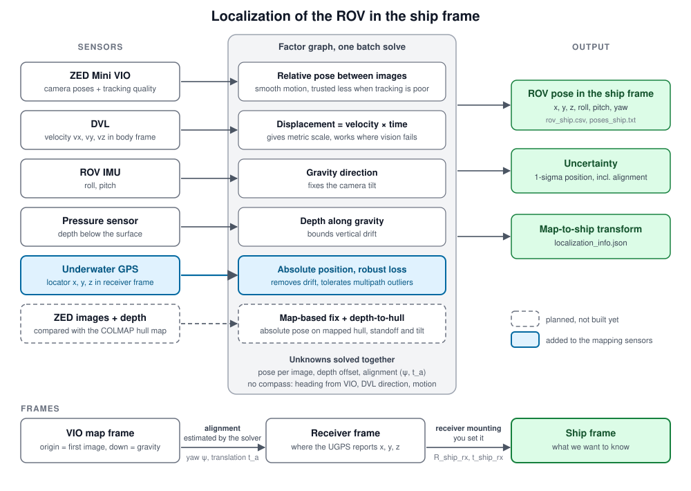

# Localization: where is the ROV with respect to the ship

Fuses the sensors already used for mapping with the Water Linked Underwater GPS (acoustic positioning) and outputs the ROV pose **in the ship frame**.

- **Dead reckoning** (same factors as `Mapping/fusion_graph.py`): ZED VIO, ROV roll/pitch (gravity), pressure depth, DVL. Smooth and metric, but x, y and heading drift.
- **Underwater GPS**: absolute position of the acoustic locator relative to the receiver. Noisy, but it does not drift. One robust (Huber) position factor per fix.
- **Alignment** between the two is solved in the same optimisation: the VIO map frame is arbitrary, so we estimate yaw about gravity + a translation (4 unknowns). Fixes taken while moving are what make the heading observable (there is no compass).
- **Ship frame**: given by where the receiver is mounted on the ship (`R_ship_rx`, `t_ship_rx`). If those are the identity, the ship frame *is* the receiver frame.



Step by step, with the equations: [method_steps.svg](method_steps.svg).

## Algorithm (in simple words)

The ROV carries sensors that tell it how it moved, and the acoustic system tells it where it is. Each one alone is not enough, so we combine them.

1. **Line up the clocks.** Every sensor reports at its own times. We match them all to the times of the camera images, so that each image has a depth, a tilt, a speed and, when available, an acoustic position.
2. **Work out the path from motion.** The camera, the speed sensor (DVL), the tilt sensors and the depth sensor together give a smooth path with the right scale. The weakness is that small errors add up, so the path slowly drifts sideways and turns.
3. **Make a first guess of where the path sits in the ship frame.** The path starts at an arbitrary place and heading. We compare it with the acoustic positions and find the turn and shift that make them fit best. Acoustic positions that are far off are ignored in this step.
4. **Improve everything together.** One optimisation adjusts the path and the turn and shift at the same time, so that it agrees with all the sensors as well as possible. Each sensor counts according to how much we trust it. An acoustic position that suddenly jumps (an echo off the hull) is given less weight, so one bad fix cannot pull the path away. The acoustic positions are what remove the drift: they pin the path to the ship wherever they are available, and in between the motion sensors fill the gaps.
5. **Give the answer in the ship frame.** Using the turn and shift from step 4 and the known place where the acoustic receiver is mounted on the ship, every image gets a position and orientation relative to the ship. We also report how uncertain each position is, including the uncertainty in how the path was placed on the ship.

There is no compass, so the heading comes from the motion sensors and from the ROV moving while acoustic positions arrive. If the ROV only moves straight up or down, the heading cannot be worked out, and the program warns about this.

<details>
<summary>Technical version (equations and parameters)</summary>

Notation: images k = 0..N-1 at times t_k with ZED pose (R_k, C_k) (camera-to-world) and tracking quality q_k; body pose R_wb = R R_bc^T, p = C - R_wb t_bc (the camera mounting from `fusion.json`); acoustic fixes j with time t_j, position z_j (receiver frame) and reported std_j; d_w = gravity ("down") direction in the map frame; u_d = down in the receiver frame (`down_in_rx`).

```
Input : ZED poses, times.txt, rov.csv (roll, pitch, depth, vx, vy, vz), uwgps.csv, config
Output: ROV pose in the ship frame per image, with 1-sigma position uncertainty

1. Synchronise
     sample roll, pitch, depth at t_k by linear interpolation (ignored if the nearest sample is > 0.5 s away)
     DVL: integrate the body velocity over [t_k, t_k+1] (trapezoid, 5 sub-steps)  ->  d_k
     fix j with t_j in [t_0, t_N-1]: find k with t_k <= t_j < t_k+1,  w = (t_j - t_k) / (t_k+1 - t_k)

2. Build the measurements
     ZED    dR_k, dt_k = relative rotation and translation between images k and k+1;  sigma divided by min(q_k, q_k+1)
     IMU    g_b,k = gravity direction in the body frame from roll, pitch
            d_w = normalised mean of R_wb,k g_b,k  (so the map frame gets a gravity axis)
     depth  z_k from the pressure sensor
     UGPS   sigma_j = max(sigma_ugps, std_j * std_scale)

3. Initialise
     poses = the ZED poses;  depth offset b = median(z_k - p_k . d_w)
     Rg    = rotation taking d_w to u_d
     p_loc,j = (1-w) p_k + w p_k+1 + R_wb t_loc                   (dead-reckoned locator position at the fix time)
     (psi, t_a) = trimmed 2D Kabsch fit of p_loc to the fixes z_j, in the horizontal plane:
                  A = Rg Rz(psi);  repeat 3 times: fit, then drop fixes whose residual > 3 x median
                  (warn if the trajectory has almost no horizontal extent: heading is then not observable)

4. Solve  (sparse trust-region least squares, Huber loss with delta = 2, at most 60 evaluations)
     unknowns: for every image a rotation correction and a translation correction, b, psi, t_a
     minimise the sum of the squared, sigma-normalised, robustified residuals
         ZED      log(dR_m^T R_k^T R_k+1),  R_k^T (C_k+1 - C_k) - dt_m
         DVL      R_wb,k^T (p_k+1 - p_k) - d_k
         gravity  R_wb,k^T d_w - g_b,k
         depth    p_k . d_w + b - z_k
         UGPS     A p_loc,j + t_a - z_j                            A = Rg Rz(psi)
         anchor   image 0 held (sigma 1 mm); weak priors on psi and t_a (they stop the solution drifting where no data constrains it)

5. Ship frame
     R_s = R_ship_rx A,   t_s = R_ship_rx t_a + t_ship_rx
     p_ship = R_s p + t_s,    R_ship_body = R_s R_wb
     uncertainty: H = J^T J at the solution; cov(p_ship,k) = G_k H^-1 G_k^T,
                  where G_k maps the unknowns (pose k, psi, t_a) to p_ship,k, so the alignment uncertainty is included
```

Why it works: the ZED, DVL, gravity and depth factors alone fix the trajectory's shape, scale and tilt, but leave position along the hull and heading free to drift. Each acoustic fix pins the absolute position, so the optimiser spreads the drift correction along the whole path; the Huber loss lets it ignore a fix that jumps (multipath). Fixes taken while the ROV moves also make the heading in the ship frame observable, so no compass is needed.

</details>

## How to run

All commands are run from this folder (`localization/`). It reuses code from `../Mapping`, so keep the two folders side by side.

### 1. Install

The code imports from the mapping repo, which must be checked out as `Mapping/` next to this folder:

```bash
git clone git@github.com:shruti-bt/SensorFusion_Mapping.git Mapping
git clone git@github.com:shruti-bt/SensorFusion_Localization.git localization
cd localization
pip install -r ../Mapping/requirements.txt      # numpy, scipy, opencv-python (COLMAP is not needed here)
```

### 2. Prepare the data folder (`DATA/`)

Use the same folder as for mapping. The images and depth maps are **not** needed here.

```
DATA/
├── poses.txt          ZED VIO poses:  name tx ty tz qx qy qz qw [quality]   (camera-to-world)
├── times.txt          image times:    name t_seconds
├── rov.csv            t,roll,pitch,depth,vx,vy,vz     (IMU, pressure, DVL)
├── fusion.json        optional: camera mounting on the ROV (R_bc, t_bc) and sensor sigmas
├── uwgps.csv          NEW: the acoustic fixes, header  t,x,y,z[,std]
└── localization.json  NEW, optional: where the receiver is mounted on the ship, and the locator offset
```

- `uwgps.csv`: locator position in the receiver frame, in metres, `z` positive down, `std` optional (what the unit reports). **`t` must be on the same clock as `rov.csv` and `times.txt`.**
- `localization.json` (every key is optional; defaults are in `DEFAULT_LOC` in [localize.py](localize.py)):

```json
{"R_ship_rx": [[1,0,0],[0,1,0],[0,0,1]], "t_ship_rx": [0,0,0],
 "down_in_rx": [0,0,1], "t_loc_b": [-0.3,0,-0.1], "sigma_ugps": 0.2}
```

| Key | Meaning |
|---|---|
| `R_ship_rx`, `t_ship_rx` | where the receiver sits on the ship; `p_ship = R_ship_rx p_rx + t_ship_rx`. Identity = ship frame is the receiver frame. |
| `down_in_rx` | which way is down in the receiver frame (default `[0,0,1]`, z down) |
| `t_loc_b` | acoustic locator position on the ROV body (forward, right, down), in metres; measure it |
| `sigma_ugps` | noise (m) used when the unit reports no std, and the minimum when it does |

### 3. Run the localization

```bash
python localize.py --data DATA --out OUT
```

### 4. Compare with dead reckoning only (optional)

```bash
python localize.py --data DATA --out OUT_DR --no-ugps
```

### 5. Check against ground truth (optional)

If you have true camera-to-ship poses (same format as `poses.txt`):

```bash
python localize.py --data DATA --out OUT --gt-ship GT_ship_poses.txt
```

It prints the position error (RMSE, maximum, last image) in the ship frame.

### 6. Look at the results

`OUT/rov_ship.csv` has the ROV position in the ship frame for every image; see the table under "Output" below. The terminal also prints how many acoustic fixes were used and how many look like outliers.

### 7. Try it without real data

```bash
python ../Mapping/synth/make_synth_fusion.py /tmp/loc_test --n 80 --seed 1      # renders a synthetic hull corner (needs opencv)
python synth/make_synth_uwgps.py /tmp/loc_test                                   # adds simulated UGPS, with the ship frame offset and rotated
python localize.py --data /tmp/loc_test --out /tmp/loc_out --gt-ship /tmp/loc_test/gt_ship_poses.txt
python localize.py --data /tmp/loc_test --out /tmp/loc_dr  --gt-ship /tmp/loc_test/gt_ship_poses.txt --no-ugps
```

Result on that simulation (3 % VIO scale error, 0.004 rad/step yaw drift, a VIO tracking loss, 4 Hz fixes with 8 cm noise, 5 % outliers and a 1.5 s dropout): position error in the ship frame **0.04 m RMSE with UGPS vs 0.32 m dead reckoning only**. With 20 cm noise and 20 % outliers: 0.11 m RMSE. This is a simulation: it checks the maths and the frames, not the real sensors.

## Output (`OUT/`)

| File | Content |
|---|---|
| `rov_ship.csv` | `name,t,x,y,z,roll,pitch,yaw,std_x,std_y,std_z`: ROV body origin in the ship frame, per image. Euler angles assume a forward-right-down ship frame; otherwise use the quaternions. `std` is the 1-sigma position uncertainty (including the alignment). |
| `poses_ship.txt` | camera-to-ship poses (`name tx ty tz qx qy qz qw`) |
| `localization_info.json` | fixes used, outliers beyond 3 sigma, `R_ship_map` / `t_ship_map` (the map-to-ship transform), residuals per factor |

## Limits and things to check on the real unit

- **Not tested on real data.** The simulated fixes are clean Gaussian noise plus jumps; near a steel hull, multipath and shadowing will be worse. Check the residuals in `localization_info.json` and tune `sigma_ugps`.
- **UGPS axes.** Water Linked's reference-frame page says the acoustic x-axis is the topside housing's forward direction, y is east relative to it and z is depth (down), with the origin on the topside housing by default, so `down_in_rx = [0,0,1]` fits. The first-generation Explorer Kit uses different axes (y forward, x east). Check your hardware, and set `t_ship_rx` for the housing position on the ship.
- **UGPS output fields and timestamps.** I could not confirm from the public docs which fields the position endpoints return, or whether they carry a measurement timestamp; check the unit's Swagger page (`/swagger`). If there is none, stamp each fix on arrival with the same clock as the other sensors. That stamp is later than the true measurement time, which costs about 25 cm at 0.5 m/s with 0.5 s of delay. A `time_offset` setting is not implemented yet. There is no logger for the unit either.
- **Gravity is assumed to be "down" in the receiver frame** (`down_in_rx`). If the ship lists or trims noticeably and the receiver is fixed to it, the alignment will be slightly off.
- **Heading needs motion.** A trajectory that is purely vertical (straight up or down) gives no heading from the fixes; the code warns when that happens.
- `std` is optimistic: it assumes the sigmas are right and ignores outliers.
- Offline only (one batch solve). Online use means running the same graph over a sliding window; not done yet.
- Not included yet: the map-based fix (PnP against the COLMAP model) and the depth-to-hull constraint. They would add more factors to the same graph.
